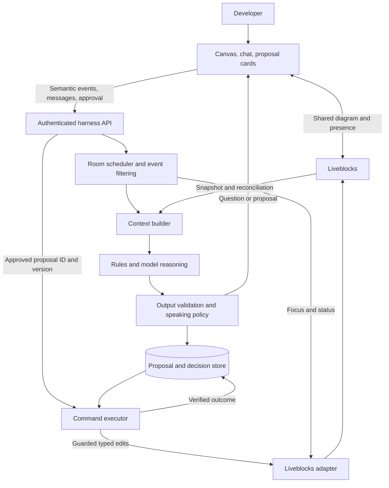
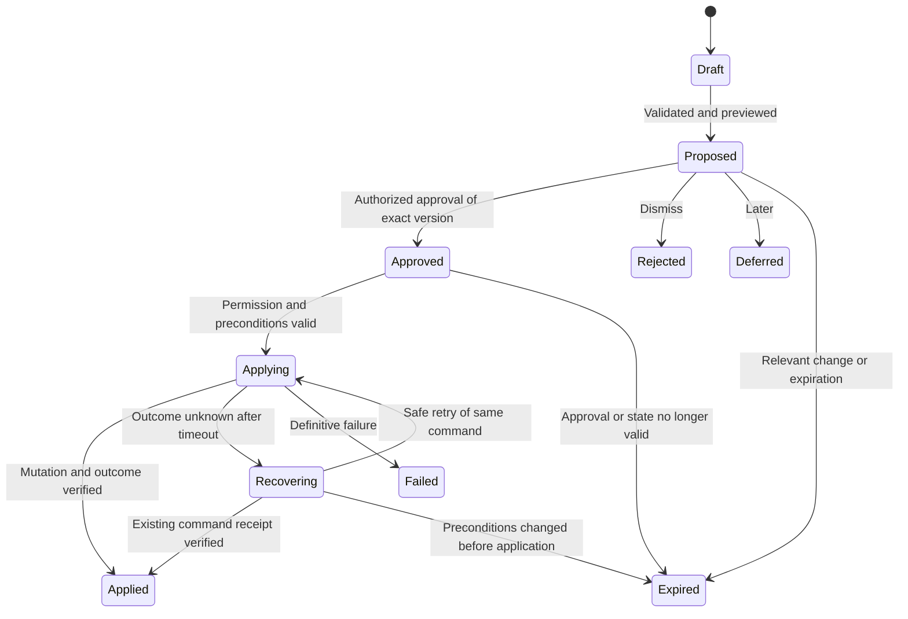

# Flowy agent harness design

Status: proposed architecture, 10 October 2026. Confirmed product choices are recorded in the README. Interfaces and timing values below are starting designs, not implemented APIs or measured performance.

Historical product design: use the [complete v1 implementation specification](v1-implementation-spec.md) as the authoritative developer handoff. The [earlier focused harness review](harness-spec.md) preserves boundary and runtime rationale. Integration details and milestones in this document are background proposals where they differ from the consolidated v1 plan.

## Product behavior

Build an always-available architecture partner for intermediate developers who are creating systems while learning. The experience is an Excalidraw-style canvas with a second visible participant: the agent has its own identity, cursor, selection, and activity. Both edit the same shared diagram. Start with text and proposal cards integrated with that canvas, and include basic agent cursor/focus behavior in the first version. Excalidraw is an interaction reference, not a selected implementation dependency.

The loop is **observe -> understand -> decide whether to speak -> ask or propose -> receive approval -> validate current state -> apply -> verify -> remember the decision**.

The agent should distinguish an invalid graph, a possible architectural risk, an unknown requirement, and a subjective preference. A component missing from a diagram is not proof that the real system lacks it.

Example: the developer connects an order service directly to an email provider. The agent asks, "Does order completion need to wait for the email to send?" If the answer is no, it can explain background delivery and offer a queue/worker preview. It also explains the operational complexity. For a small prototype, the direct connection may be reasonable.

Success means the developer makes a better-informed decision without losing their flow. Useful questions and appropriate silence count alongside accepted edits.

## Joining, understanding intent, and refining the design

The agent's first job on joining is to establish shared understanding. Its opening flow is **orient -> clarify missing intent -> reflect a design brief -> collaborate**, with clarification continuing as the design evolves.

1. **Orient to the canvas.** Read the current graph, labels, annotations, viewport, selection, and available session history. Start from what already exists. On an empty board, ask what the developer wants to build. On returning sessions, recover known decisions and ask only about changed or missing context.
2. **Clarify purpose and boundaries.** Ask what is being built, who it helps, which problem matters, and which flows belong in the current scope. Explicitly record what is out of scope. Ask one or two related questions at a time, grounded in the drawing where possible.
3. **Clarify scale and constraints.** Distinguish launch expectations from possible future scale. Users, concurrent activity, requests, and data volume mean different things; request the relevant measure rather than treating a user count as throughput. Rough ranges and unknown answers are acceptable. Explore latency, reliability, budget, deployment, and learning goals when they affect a choice.
4. **Reflect a brief.** Present a short editable summary of purpose, users/key flows, current scope, excluded work, expected scale, constraints, and unresolved assumptions. Invite correction. Confirming the brief establishes context; it does not authorize canvas mutations.
5. **Refine together.** Review the existing design against that brief, trace the main flow, identify the next useful question or tradeoff, and offer a small proposal when warranted. Point to the relevant canvas elements while discussing them. Update the brief as requirements change and revisit affected suggestions.

The initial conversation is progressive rather than a blocking questionnaire. Begin helping once the immediate task is understood; ask further questions only when their answers could change the next decision. User-stated unknowns remain unknown. Temporary assumptions must be visible and cannot silently become confirmed requirements.

"Seeing the screen" means understanding the in-app canvas and the developer's current focus. Prefer structured canvas state for exact identities and connections. A canvas image can supplement this for freehand sketches, spatial grouping, or visual annotations. Treat visual interpretation as uncertain until grounded in entities or confirmed by the user; do not depend on repeated screenshots for every edit. Track changes that happen while the agent is orienting so its opening response stays current.

Example opening, after observing a service and database: "I see a service connected to a database. What are you building, and which user flow should we design first?" Once answered, the agent can ask whether the goal is a working MVP or a larger deployment and what initial usage is expected. Its brief could read: "A task app for a small team; tasks and comments in scope; billing out of scope; launch traffic still unknown; keep operations simple."

Acceptance checks: an empty board produces a useful opening; a populated board receives grounded questions; returning sessions do not repeat answered questions; unknown scale does not block collaboration or produce fabricated traffic; a changed scope updates the brief and invalidates affected proposals.

## Component design and ownership

The harness owns the agent lifecycle and decisions. The canvas owns rendering, gestures, previews, and user input. A collaboration adapter translates domain contracts into Liveblocks operations.



Initially deploy one TypeScript/Node.js backend service. These boxes are modules, not microservices. Allow one active model-backed reasoning run per room, with deterministic scheduling and execution. Model/provider selection remains open until evaluation.

| Module | Responsibility | Why it matters |
| --- | --- | --- |
| Ingress | Authenticate, authorize room access, validate input, acknowledge event IDs | Browser payloads cannot grant their own permissions |
| Room scheduler | Coalesce edits, cancel obsolete analysis, enforce budgets | A busy canvas must not produce overlapping conversations |
| Context builder | Read graph neighborhoods, goals, decisions, unresolved questions | Advice must refer to the developer's actual design |
| Reasoning | Run graph checks, then use the model for questions and tradeoffs | Structural checks and architectural judgment differ |
| Interaction policy | Allow silence, rank usefulness, suppress repeats, choose timing | Collaboration includes knowing when not to interrupt |
| Action presentation | Coordinate cursor targets, highlights, previews, text, and confirmed changes | The agent's visible activity must match its actual work |
| Proposal manager | Store previewable changes, dependencies, versions, approval status | The user must know exactly what they are approving |
| Executor and adapter | Recheck state and permission, apply commands, verify outcomes | Model output is not permission to mutate a room |
| Evaluation and tracing | Replay sessions and measure relevance, latency, cost, correctness | A convincing demo alone does not establish reliability |

## State and context model

| State | Minimum content | Proposed owner |
| --- | --- | --- |
| Architecture | Stable node/edge IDs, component kinds, responsibilities, protocols, boundaries, explicit properties | Liveblocks persistent document |
| Design intent | Problem, key flows, scale assumptions, latency/reliability needs, budget, constraints, design stage | Explicit room context; authoritative fields in the persistent document |
| Collaboration | Focused component, gesture, selection, agent status/cursor | Temporary presence and short-lived harness context |
| Agent history | Questions, answers, accepted tradeoffs, rejected/deferred suggestions, proposals | PostgreSQL |

Separate semantic architecture data from visual layout. Moving a box by 20 pixels should not invalidate a suggestion about delivery guarantees. Moving it into a trust boundary is semantic and must produce a corresponding event.

Each fact carries provenance: user-stated, diagram-observed, imported, or inferred. Inferences remain assumptions until confirmed. Unknown throughput stays unknown.

Start with component types such as client, service, database, queue, cache, external system, and boundary. Allow unknown/custom types. Edges capture meaning where known: request, publish, consume, read, write; protocol; sync/async behavior. Let people sketch without completing a detailed form for every box.

Collect context progressively: what they are building first, then traffic or failure behavior when a decision depends on it. Track whether this is a high-level sketch or a deployment review.

Model input contains the recent semantic diff, affected neighborhood, compact full-system summary, relevant requirements/decisions, and unresolved questions. Retrieve additional graph regions when needed. Do not silently truncate a graph and claim a complete review. Store snapshots/diffs used by each run so the same observation can be replayed.

## Events and scheduling

Two loops run at different speeds: awareness follows focus and observed state; reasoning runs on meaningful changes, explicit questions, or requested reviews.

| Event | Default handling |
| --- | --- |
| Pointer movement, pan, zoom | Presence/rendering only; no model invocation |
| Selection or focus | Update attention context; usually remain silent |
| Dragging | Synchronize layout; wait for gesture completion |
| Add/delete node, connect/disconnect edge, change semantic property | Coalesce, then analyze the meaningful diff |
| Rename component | Analyze a changed meaning, not every keystroke |
| Goal/constraint update or user answer | Refresh context and revisit affected questions |
| Explicit message/review | Prioritize a reasoning turn |
| Approval/rejection/defer | Update the durable proposal workflow |
| Agent-origin change | Verify and refresh state; suppress immediate self-triggered suggestions |

Suggested initial policy: debounce semantic edits for 750-1500 ms; show one proactive question/card at a time; apply a roughly 20-30 second cooldown to unsolicited interruptions. These are tuning parameters. Explicit messages bypass that cooldown. Bound each run's duration, tool calls, and token budget.

When an edit invalidates running analysis, cancel where possible and always discard stale output. Coalesce remaining work into the latest state. A new event does not imply a model call.

Proposed event envelope:

```ts
type CanvasEvent = {
  schemaVersion: 1;
  eventId: string;
  roomId: string;
  clientSessionId: string;
  clientSequence: number;
  kind: string;
  entityIds: string[];
  payload: unknown; // Validated with a per-kind schema at ingress.
  observedStateHash?: string;
  causationId?: string;
};
```

The server attaches authenticated identity, receipt time, and trusted origin. Session sequence numbers detect gaps; client timestamps do not define global order. Deduplicate by event ID. An observation event cannot carry an executable patch.

Use authenticated HTTP events for ingress and SSE for streamed text/status if needed. The browser reports its own committed semantic actions, not every remote update it receives. Reconcile snapshots on room activation, connection gaps, and periodic recovery.

Events may arrive before their Liveblocks writes. Treat them as hints until the adapter confirms the referenced state. If intermediate versions are already superseded, coalesce to the current state. Do not claim exact history from lossy UI hints.

Persist important workflow inputs before acknowledging them and retain a bounded client retry buffer. If a gap cannot be recovered, refresh the snapshot instead of guessing history.

## Liveblocks integration

Storage update webhooks are documented as throttled to 60 seconds and may omit individual writes. Use them for reconciliation and background bookkeeping, not as the only live trigger. [Webhook reference](https://liveblocks.io/docs/api-reference/webhook-events#StorageUpdatedEvent)

Use persistent state for the diagram and Presence for focus/status. Server-side `setPresence` can show an agent with expiring presence. Send a focus target or occasional position and animate in the UI; model calls should not generate animation frames. Clearly label the agent cursor, allow it to be hidden, and leave the developer's actual cursor under their control. [Node API](https://liveblocks.io/docs/api-reference/liveblocks-node)

Broadcast notifications can tell clients to refresh a proposal. Durable proposal and approval records remain recoverable from the backend after disconnects.

For guarded edits, the documented Storage JSON Patch endpoint supports `test` preconditions and rejects the entire patch when an operation fails. Generate patches from validated domain commands. [JSON Patch guide](https://liveblocks.io/docs/guides/modifying-storage-via-rest-api-with-json-patch)

The alternative `mutateStorage` callback supports native Storage manipulation, but asynchronous changes can flush separately; it is not a database transaction. [Server-side editing](https://liveblocks.io/docs/products/sync/server-side-editing)

Hide integration behind four capabilities: read a snapshot, publish focus/status, notify about a proposal, and apply guarded commands. Use a fake adapter during development. If the canvas selects Yjs or another document model, implement its matching adapter rather than assuming Storage patches apply.

## Shared-canvas action experience

Presence, streamed activity, and document edits work together. Liveblocks documents Presence for agent identity/focus, Feeds for streamed text and persistent status, and Sync for editing shared documents. These are distinct responsibilities that our action presentation layer coordinates. [Agentic users](https://liveblocks.io/docs/use-cases/agentic-users)

Example interaction:

1. The human connects an order service to an email provider.
2. The agent's cursor approaches the connection and highlights it while asking whether order completion should wait for email.
3. If a change is useful, a ghost preview appears on that same canvas beside the proposal card.
4. After approval, the agent focuses the affected area and applies the approved change to the shared document. Everyone sees the same resulting components and connections.
5. The cursor and status settle when execution is confirmed. On failure, remove the preview and explain the outcome; do not animate a successful edit that never committed.

Represent visible actions with a stable action ID, ordered sequence number, target entity IDs or canvas coordinates, phase, and associated proposal/command ID. Phases can include focusing, previewing, applying, and complete. Clients ignore outdated action updates. The presenter follows execution acknowledgements; an animation finishing cannot authorize or confirm a document mutation.

Use world/canvas coordinates and transform them through each viewer's pan/zoom. Interpolate movement locally for smoothness. Re-resolve target positions when a human moves the target, and cancel the visual action if it disappears. Respect reduced-motion settings. Do not send every rendered animation frame through the model or persistent document.

For an apparent drag, render a temporary preview at intermediate positions and commit the final authorized edit through the guarded executor. Keep coupled structural changes atomic; a multi-part proposal must not expose an invalid graph merely to imitate hand drawing. Make previews visibly distinct from committed changes.

Human editing continues during agent activity. If a human changes a relevant target, invalidate or revalidate the proposal instead of fighting over it. Layout-changing commands must also test the affected layout fields even though architecture reasoning normally ignores layout.

Always available means the service can resume the buddy with saved context whenever a developer returns. Inactive rooms need no continuous inference. Agent presence should expire or show the actual available/working state, rather than suggesting it is thinking while its worker is disconnected.

## Reasoning and interaction policy

The model returns one structured decision: `silent`, `ask`, `suggest`, or `answer`. It can request bounded read-only context tools first. Validate output before displaying it.

Suggestions identify observed evidence, the relevant requirement, uncertainty, a concise explanation, a tradeoff, and affected entity IDs. Save a short rationale and tool outcomes, not private model reasoning traces.

Use deterministic rules for dangling edges, invalid IDs, and explicitly incompatible properties. Use model judgment for whether coupling or a failure mode fits the stated goal. A cycle is not automatically a bug; a queue or cache is not automatically an improvement.

The interaction policy checks relevance, unresolved information, freshness, design stage, previous answers, and interruption cost. Model confidence alone is insufficient.

- Ask one concrete question when a missing requirement changes the recommendation.
- Explain one tradeoff using the developer's components and vocabulary; offer optional detail.
- Respect "later", "out of scope", and accepted risks. Revisit when relevant context changes or the user asks.
- Allow proactive suggestions to be muted and reviews to be requested explicitly.
- Attribute questions and decisions when several people are present; make proposal ownership clear.

## Proposal and approval lifecycle

A saved proposal contains its ID/version, room, author, timestamps, status, observation, recommendation, evidence, assumptions, tradeoff, exact typed commands, preview, semantic preconditions, approval identity/time, command ID, and outcome.

The card exposes **Apply**, **Discuss**, **Dismiss**, and **Later**. A ghost preview remains outside the committed graph. Apply submits the proposal ID and version, never a fresh model-generated plan. For the MVP, conversational "yes" does not silently authorize an ambiguous or changed patch.



Initial mutation commands: `add_component`, `update_component_fields`, `connect_components`, `remove_connection`, and `remove_component`. Validate IDs, allowed fields, endpoints, operation limits, and deletion dependencies. Read tools include `get_graph_neighborhood` and `get_design_context`. The reasoning model has no direct mutation credentials.

Execution:

1. Load the stored proposal; verify the approving user's current room permissions.
2. Claim execution with a stable command ID. Simultaneous approvals cannot create separate executions.
3. Read current state and validate the approved commands. Relevant changes require a new proposal and approval.
4. Compile commands into one guarded patch with preconditions and an application receipt.
5. Apply via the adapter and verify the outcome before reporting success.
6. Persist the accepted decision and outcome; refresh context without an unsolicited feedback loop.

The model cannot supply arbitrary JSON Patch paths, run code, access arbitrary URLs through tools, or hold Liveblocks secrets. Treat labels, imported documents, and diagram notes as untrusted content, not harness instructions.

## Concurrency, recovery, and undo

For small initial graphs, test the full expected semantic architecture subtree and authoritative design-intent fields before mutation. Exclude cursor data and unrelated layout; when a command changes layout, also guard the affected layout fields. The checks must cover requirements used in the recommendation as well as graph entities. This conservatively invalidates a proposal after even unrelated semantic edits. Later, use dependency-scoped checks once their completeness is tested.

A client-incremented global revision is not a safe compare-and-swap mechanism during concurrent edits. Use server-evaluated preconditions on actual state. Reading before an unguarded write still races.

Checks cover edits already visible to the collaboration service. Subsequent human edits, including reconnecting offline changes, can still alter the design. Revalidate the resulting graph; approval does not prevent future conflicts.

Use one execution claim per proposal in PostgreSQL, with a command receipt written in the same document patch as the edit. Implement an atomic duplicate guard, for example a uniquely initialized receipt slot checked by `test`, so retries cannot repeat a mutation. Deterministic IDs for new entities help recovery. Receipts support recovery; backend approval records remain the authority for permissions.

Liveblocks and PostgreSQL are not one transaction. Persist execution intent first. If the process dies after a room mutation but before recording success, read the receipt and verify the outcome. An unknown timeout does not justify applying again blindly. Prove recovery in the integration spike before enabling edits.

Undo creates a compensating command guarded against subsequent edits. If another developer changed affected objects, offer a conflict explanation or new preview. Do not restore the entire room over unrelated work. Do not assume human undo history automatically owns server-origin edits.

On restart, reload unresolved proposals, recover applying commands, fetch current state, and resume from a known snapshot. Expire old agent presence. Canvas editing remains usable when the model or harness is unavailable.

## Minimal implementation shape

| Piece | Starting choice | Reason |
| --- | --- | --- |
| Harness | TypeScript/Node.js, one service | Fits Liveblocks and shares domain types with the UI |
| Model | One provider SDK, schema-constrained output, bounded read tools | Keeps scheduling and mutation policy in our code |
| Validation | Shared domain schemas, validated again on server | Types do not validate network input |
| Persistence | PostgreSQL | Durable sessions, decisions, proposals, approvals, executions, important events |
| Scheduling | One active room run, bounded pending work, persisted recovery | Avoids a separate broker initially |
| Collaboration | Liveblocks adapter | Diagram state, presence, guarded mutation delivery |
| Evaluation | Fake model/adapter, recorded traces, real integration suite | Separates harness correctness from model variability |

Before multiple worker instances, add room ownership leases with fencing so an old worker cannot publish after losing ownership. Add a queue service when throughput or deployment needs justify it. Defer vector/graph databases and multiple specialist agents.

Proposed boundaries, to create during implementation:

```text
packages/domain/       Graph, event, proposal, command schemas
apps/agent/            Ingress, scheduler, context, reasoning, executor
apps/agent/adapters/   Liveblocks and model integrations
evals/                 Recorded interactions and scoring
```

Scope every persisted lookup by tenant and room. Do not durably store raw pointer histories. Set explicit retention for user text and run traces. Structured decisions and recent history suffice before adding retrieval infrastructure.

## Build order

| Milestone | Deliverable | Acceptance gate |
| --- | --- | --- |
| 1. Domain and integration spike | Graph/event/command schemas; guarded Liveblocks adapter; minimal test room with human and agent cursors | Two clients see the same agent focus; cursors align across pan/zoom; stale patch fails; retry cannot duplicate an edit; presence expires |
| 2. Harness without full UI | Fake canvas, event replay, room state, scheduler, context builder | Drag bursts cause no reasoning; semantic edits coalesce; event gaps reconcile; stale output is discarded |
| 3. Read-only collaborator | Text questions and suggestions linked to entities, with coordinated agent cursor/highlights | Cursor points to the subject being discussed; advice uses evidence/goals; unknowns become questions; dismissal suppresses repeats |
| 4. Proposal execution | Same-canvas preview, approval, visibly coordinated edits, recovery, guarded undo | Approved changes appear on the shared canvas; visuals match confirmed execution; stale/unauthorized approval fails; restart resolves an ambiguous apply |
| 5. Collaboration polish | Refined motion, streaming, interruption controls, multiple-human behavior | Focus is responsive without extra model calls; explicit requests take priority; shared proposals have one outcome |

First end-to-end scenario: draw an order service calling email, see the buddy point to the connection, discuss whether checkout waits, preview asynchronous delivery if appropriate, approve, watch the agent work on the same canvas, and undo without disturbing unrelated changes.

Develop the headless replay harness alongside a minimal shared-canvas presence slice. Replay exposes timing, context, and proposal failures; the canvas slice tests whether the buddy feels present. Refined animation can follow, but basic cursor behavior is part of the first experience.

## Evaluation and limits

Start with roughly 20-30 scripted traces: correct designs where silence is appropriate, incomplete sketches, intentional simplifications, missing requirements, rapid edits, duplicate events, concurrent edits, rejection, reconnect, malicious diagram text, and a crash after applying a patch.

- Hard gates: no unauthorized edit, duplicate application, stale guarded mutation, introduced dangling reference, or preview/command mismatch; recover ambiguous outcomes.
- Human scoring: evidence grounding, useful questions, accurate tradeoffs, appropriate timing/silence, clarity for intermediate developers.
- Operating measures: event-to-useful-response latency, tokens/cost per active minute, calls per meaningful edit, stale-run discard rate, repeated questions, acceptance, subsequent undo, interruption feedback.

Aim for useful feedback within a few seconds after a meaningful pause, then measure p50/p95 on representative graphs and networks. This is an experience target, not a guarantee. Acceptance alone is insufficient: correct suggestions can be declined and excessive prompting can inflate activity.

## Open decisions

The broader audience remains exploratory; the intermediate-developer direction is enough for the first slice. Choose the canvas document representation before implementing the adapter. Agree on component/edge types and minimum design context. Define who can approve shared proposals. Select a model against our traces, then set cost and latency budgets.

Verify concurrency and retry behavior in the integration spike. This design reflects current documentation and has not been tested against a running Liveblocks project.
