# Flowy core: first implementation design

Status: design for the first coding phase. This document deliberately covers the agent core only. The broader [v1 implementation specification](v1-implementation-spec.md) is a roadmap for later phases; when it asks for authentication, HTTP, PostgreSQL, Liveblocks, or a canvas, those pieces are out of scope until we agree to move beyond the core.

## Goal

Build the smallest real piece of Flowy: software that takes a design snapshot and meaningful user events, understands the current task, and returns a safe, useful agent decision. It should be possible to run and replay this core locally without a UI, network connection, database, provider key, or account system.

The first core should establish that Flowy can:

- distinguish meaningful architecture changes from cursor noise;
- form bounded context from a graph, brief, and prior decisions;
- choose to stay quiet, ask a question, answer, or prepare a proposal;
- validate a proposed change against the graph;
- produce a proposal the main app can present for approval and applying;
- preserve predictable behavior across replay and simulated failures.

The architecture buddy should help an intermediate developer learn. A missing box is not evidence that the real system lacks it. Unknown requirements remain unknown. Explanations should connect a recommendation to the user's goal and describe its tradeoff.

## Scope boundary

This phase is one local TypeScript package, one command-line replay/demo, pure core logic, and recorded input/output fixtures. The harness is a separate product/service. The main web application calls it through a connector or MCP integration and owns all canvas and collaboration behavior.

It does not implement login, identity verification, permission checks, HTTP/SSE, PostgreSQL, a durable queue, a real model/provider, a canvas UI, Liveblocks, presence, cursor rendering, cloud hosting, Docker, or multi-instance workers. It does not approve or apply graph changes. No component in this phase should pretend that a recorded approval proves a real user had permission or that a proposal was applied.

Keep a typed, versioned integration boundary for the Flowy web app, but do not pre-build abstractions for arbitrary products. The only domain we design for is Flowy's architecture graph.

## Core architecture

```mermaid
flowchart LR
    I[Recorded room snapshot + events] --> N[Normalize and reduce]
    N --> P[Trigger and speaking policy]
    P -->|No useful work| S[Silent result]
    P -->|Reasoning task| C[Bounded context builder]
    C --> R[Architecture buddy policy]
    R --> V[Validate decision]
    V --> D[Question, answer, or proposal]
    D -->|Proposal| K[Compile proposal operations]
    K --> H[Structured response to main web app]
    H --> A[Main app presents preview and collects approval]
    A --> X[Main app validates and applies the edit]
    X --> O[Host reports verified outcome to harness]
```



Keep the core independent of transport, storage, UI, and model SDKs. Use ordinary TypeScript interfaces for boundaries; do not add a dependency-injection framework. The first demo replays recorded requests and responses directly.

Suggested source layout:

```text
packages/core/src/
  domain/       graph, brief, events, decisions, proposals, commands
  observation/  event reduction and semantic diffs
  policy/       trigger eligibility and speaking policy
  context/      evidence selection, provenance, coverage
  reasoning/    model port and decision validation
  proposals/    command compilation, preconditions, preview
  lifecycle/    question/proposal/turn transitions
  response/     outbound response assembly and host-outcome intake
  index.ts      public core API
tools/replay/   JSON fixtures, CLI, fake model and replay caller
```

These are logical modules; keep the implementation small. If a file split adds indirection without clarifying an interface, keep the code together.

## Domain data

Use Zod for runtime input validation and inferred TypeScript types. Every fixture/event declares `schemaVersion: 1`. Reject unsupported versions, duplicate IDs, non-finite geometry, dangling edge references, malformed boundaries, and oversized inputs. Unknown component kinds and incomplete drafts remain valid.

### Architecture snapshot

The canonical snapshot supplied to the core contains:

- `roomId` and opaque semantic/layout version strings;
- nodes with stable IDs, kind, label, optional description, bounded properties, boundary, and world-coordinate layout;
- edges with stable IDs, endpoints, kind, protocol, sync/async/unknown mode, and bounded properties;
- a confirmed brief or `null`;
- recent confirmed decisions and unresolved questions;
- coverage information saying which entities were included, whether the snapshot is complete and synchronized, and any known omissions.

Initial node kinds: client, service, database, queue, cache, external system, boundary, unknown, and custom. Initial edge kinds: request, publish, consume, read, write, and unknown. Do not require the developer to fill out every property before sketching.

Keep layout separate from meaning. A normal box movement changes layout version only. Changing a node's responsibility, edge mode, connection, or trust boundary is semantic. The host determines the version strings; the core compares equality and does not assume they are integers or timestamps.

### Brief and provenance

The brief records purpose, users, key flows, in-scope/out-of-scope items, project stage, scale estimates, constraints, and open questions. Each claim states whether it came from the user, the graph, an imported source, or an inference. Inferences are tentative. Missing scale is `unknown`, not zero and not an excuse to invent traffic.

The core may propose a brief draft with a question. It never commits that draft as a confirmed requirement. In this phase the CLI's explicit user response can confirm it in the in-memory fixture.

### Events

Normalize input into a small event union:

```ts
type CoreEvent =
  | { type: "room.opened"; snapshot: RoomSnapshot }
  | { type: "graph.semantic_changed"; entityRefs: EntityRef[]; snapshotRef: SnapshotRef }
  | { type: "graph.layout_changed"; entityRefs: EntityRef[]; snapshotRef: SnapshotRef }
  | { type: "focus.changed"; entityRefs: EntityRef[] }
  | { type: "brief.changed"; snapshotRef: SnapshotRef }
  | { type: "user.message"; messageId: string; text: string; entityRefs: EntityRef[] }
  | { type: "question.answered"; questionId: string; responseId: string; text: string }
  | { type: "proposal.response_recorded"; proposalId: string; version: number;
      responseId: string; action: "approve" | "reject" | "defer" | "revisit" }
  | { type: "proposal.outcome_reported"; proposalId: string; version: number;
      result: "applied" | "conflict" | "denied" | "failed" | "unknown";
      resultingSnapshotRef?: SnapshotRef; explanation?: string };
```

These are domain events passed directly to the core, not an authenticated API contract. A real connector will define how the main app authenticates calls and supplies verified scope/actor metadata. Permission checks and edit execution remain in the main app. Transport-specific deduplication and event reconciliation belong outside this first phase.

## Core processing flow

Implement one public operation for advancing the local state:

```ts
advance(state, input, dependencies) -> { state, effects }
```

`state` is explicit data, not a hidden singleton. `input` is a validated current snapshot plus one event or a batch of normalized events. `dependencies` provide a model port. `effects` are requested next actions such as “run reasoning with this context” or “return this question/proposal to the caller”. The replay driver feeds recorded host outcomes back as new inputs. This keeps state transitions testable without executing external side effects inside a reducer.

For each event batch:

1. Validate the snapshot and events.
2. Compare snapshot refs; compute semantic and layout differences from canonical snapshots where available. Do not trust an event label without the corresponding snapshot.
3. Update current focus and room context. Drop pointer-frame data entirely; it is not a core event.
4. Decide whether reasoning is eligible. Direct user messages and answers are eligible immediately. Meaningful semantic changes are eligible after a configurable quiet period. Layout/focus changes alone are context hints and do not trigger model work.
5. If work is eligible, make a context manifest from the latest snapshot, task, evidence, coverage, and relevant decisions.
6. Call the model port with a bounded request, or use the fake model in the first milestone.
7. Validate the returned decision and evidence references. Recheck snapshot version before publishing a final response.
8. For proposals, compile commands, validate the resulting graph on a copy, and create a preview. Save this as inert proposal data.
9. Return a structured response containing the exact validated proposal operations and source versions. The main app displays its preview, obtains user approval, checks permission and current canvas state, and applies it.
10. When the main app reports the proposal outcome, record that result and respond truthfully. The harness never reports an edit as applied before receiving the host's verified result.

The first replay demo may treat the CLI as a single synchronous event loop; it still uses the same explicit state and response boundary. Debounce is simulated by replay time, not real sleeps.

## Trigger policy

Use deterministic code for eligibility and an explicit model decision for content:

| Input | Core behavior |
| --- | --- |
| Room opens with no brief | Ask what is being built and which flow matters first |
| Room opens with known brief | Reflect relevant known context and continue; do not repeat onboarding |
| Pointer, pan, zoom, or focus-only change | Update focus hint or ignore; no reasoning request |
| Repeated semantic edits in a burst | Coalesce to latest snapshot at quiet-period boundary |
| Explicit question/message | Prioritize it and answer, ask a needed question, or explain a limit |
| User answer | Correlate by question ID and reconsider using fresh context |
| Agent-applied command | Refresh snapshot and suppress immediate self-review |
| Valid design with no useful next intervention | Return `silent` |

Start with a 1 second semantic quiet period and one proactive concern at a time. Keep these settings in a `CoreConfig`; replay scenarios can override time to make tests deterministic. Do not implement a production queue or timer service in this phase.

## Context builder

Build a named `ContextBundle` before the model call. It includes the user's immediate task, confirmed brief, selected entities, changed semantic diff, their one-hop graph neighborhood, relevant decisions and open questions, provenance, snapshot refs, coverage/omissions, and the output/tool budget.

Use the focused entities first. If the input concerns a flow, include its nodes and edges; do not send the entire graph by default. If the graph is larger than the configured limit, include a marked partial summary with omitted count and ask for a narrower review when necessary. Never tell the model that a partial region is a complete system view.

In phase one, the model receives no tools. Add read-only graph lookup later only if replay/evaluation shows the bounded context is insufficient. The context builder is deterministic so the same fixture and versions produce the same bundle.

## Decision and model boundary

The model port accepts a context bundle, output schema, budget, and cancellation signal. It returns one candidate:

- `silent`: no useful proactive intervention;
- `ask`: one contextual question, optionally with an unconfirmed brief draft;
- `answer`: response with evidence references and limitations;
- `propose`: explanation, tradeoffs, evidence, and typed operations.

The model does not receive tenant selection, mutation credentials, shell access, arbitrary network access, approval authority, or a direct canvas writer. In this phase, a fixture-driven fake adapter proves that the runtime handles each output class. A real model/provider is a later phase after the contracts and evaluations are stable.

Validate shape with Zod, then validate meaning deterministically: referenced IDs exist in the supplied context; commands use known operations and fields; added IDs are unique; removals name existing objects; resulting edges reference existing nodes; evidence has provenance. Structural validity does not prove that the architecture advice is correct, so measure advice separately with reviewed scenarios.

Never store or display hidden model reasoning. Persist the user-facing explanation, evidence references, decision type, and test metadata only.

## Proposal and command lifecycle

Use typed operations only:

```ts
type Operation =
  | { type: "add_node"; node: ArchitectureNode }
  | { type: "update_node"; id: string; changes: SupportedNodeChanges }
  | { type: "move_node"; id: string; layout: WorldLayout }
  | { type: "remove_node"; id: string }
  | { type: "add_edge"; edge: ArchitectureEdge }
  | { type: "update_edge"; id: string; changes: SupportedEdgeChanges }
  | { type: "remove_edge"; id: string };
```

Do not expose generic object paths, JSON Patch, SQL, JavaScript, or shell commands to the model. Compile additions with stable IDs once. Apply a candidate operation list to a copy of the snapshot; reject the entire proposal if any operation or resulting graph is invalid. Require incident edges to be handled explicitly when a node is removed.

A proposal stores ID, version, source snapshot refs, normalized operations, human explanation/tradeoffs, evidence, a preview representation for the main app, and a deterministic digest of the exact operations and preconditions. The main app renders the preview, requests approval, checks current permission/state, applies the edit, and reports the result to the harness. A changed proposal is a new version and needs new approval in the app.

Use these core states to track the conversation and reported host result:

```text
turn: ready -> reasoning -> completed | waiting_for_answer | waiting_for_approval
question: open -> answered | dismissed | superseded
proposal: drafted -> returned_to_host -> awaiting_host_outcome
                                  -> applied | conflict | denied | failed | unknown
                                  -> rejected | deferred | expired | superseded
```

The replay fixture can include an approval and outcome for learning and tests. The harness records those as caller-provided facts. They do not establish who the actor is or whether they were permitted to approve. The main app must check identity and permission and apply the edit before reporting an outcome.

Use conservative freshness: any semantic version change expires the proposal; a layout-dependent change expires layout-sensitive proposals. Include source refs and the exact digest so the main app can check them again. The harness never asks the model to regenerate commands after approval.

## Caller contract and execution boundary

The core boundary is protocol-neutral and versioned. A request supplies a room-scoped snapshot, relevant change/user message, brief, decisions, current focus, and coverage. A response is one of `silent`, `ask`, `answer`, or `propose`, with schema version, correlation ID, source snapshot reference, evidence, and any typed proposal operations. Responses may include a client-facing status or explanation for unsupported/incomplete input.

Use one request/response schema regardless of transport. For example:

```ts
type AnalyzeRequest = {
  schemaVersion: 1;
  requestId: string;
  room: { roomId: string }; // caller-supplied scope; no auth is implemented in core
  trigger:
    | { type: "room_opened" }
    | { type: "semantic_change"; entityRefs: EntityRef[] }
    | { type: "user_message"; messageId: string; text: string; entityRefs: EntityRef[] }
    | { type: "question_answer"; questionId: string; responseId: string; text: string }
    | { type: "proposal_response"; proposalId: string; version: number;
        responseId: string; action: "approve" | "reject" | "defer" | "revisit" }
    | { type: "host_outcome"; proposalId: string; version: number;
        result: "applied" | "conflict" | "denied" | "failed" | "unknown";
        resultingSnapshotRef?: SnapshotRef };
  snapshot: RoomSnapshot;
  recentMessages: Message[];
  decisions: Decision[];
  focus: EntityRef[];
};

type AnalyzeResponse = {
  schemaVersion: 1;
  requestId: string;
  turnId: string;
  sourceSnapshotRef: SnapshotRef;
  decision:
    | { kind: "silent"; reason: string }
    | { kind: "ask"; text: string; evidence: EvidenceRef[]; briefDraft?: BriefDraft }
    | { kind: "answer"; text: string; evidence: EvidenceRef[]; limitations: string[] }
    | { kind: "propose"; title: string; explanation: string; tradeoffs: string[];
        evidence: EvidenceRef[]; proposal: Proposal };
};
```

The exact field names can be refined when implementation begins, but both schemas must be shared by the core and its adapters. `requestId` correlates retries and responses; `turnId` correlates a multi-step conversation. The response includes enough source context for the main app to reject stale proposals. Keep caller-supplied actor/scope claims untrusted until a future service adapter verifies them.

The main app invokes analysis after a meaningful event or an explicit message and includes the latest snapshot. It does not send pointer frames. The core can coalesce a batch in the local replay loop; event subscription and continuous streaming are not part of the first contract. A connector and an MCP adapter, if both are ever needed, translate to this same request/response shape. They do not contain separate agent logic. Choose which adapter to build after the main app's integration pattern is known. If the app can call a normal request/response connector, that is the direct fit for pushing semantic event batches. MCP is an option when the main app already acts as an MCP client and can invoke a bounded `analyze_design` tool; do not rely on MCP for canvas presence or raw event streaming.

The main web app owns preview rendering, approval collection, access checks, stale-state checks, applying edits, idempotency receipts, and the authoritative canvas. It sends an outcome event back to the harness after applying or rejecting a proposal. The harness owns reasoning state and must never claim a proposed edit was applied until that outcome arrives.

In phase one, a `ReplayCaller` reads request fixtures, invokes the core, records its response, and can feed a simulated host outcome back in. It performs no graph writes. A fake caller is useful for contract tests but must not simulate authorization or mutation success unless the fixture explicitly supplies that result.

The model returns typed proposal data but cannot execute it. The main app remains responsible for translating an approved response into a guarded canvas command. Undo is also a main-app action; its reported result can be fed to the harness as another event.

## In-memory state and replay

Represent core state as plain serializable data: current snapshot refs, current brief/decisions, focused entities, coalesced pending semantic work, current turn/attempt, waiting questions/proposals, suppression keys, and host-reported outcomes. Keep the main app's canonical graph, approvals, permissions, and command receipts outside harness state.

Version one does not promise persistence across process restart. The replay CLI serializes starting fixtures and prints responses after each input, so cases are repeatable and debuggable. Shape state so a later repository can serialize it; do not add migrations, event sourcing infrastructure, or distributed locking now.

## First code milestones

**C0 — Contracts and pure validation.** Define graph, brief, event, evidence, decision, operation, proposal, and result schemas. Implement graph and command validation plus deterministic proposal digesting.

**C1 — Observation and context.** Build snapshot diffing, event classification, focus/selection capture, coalescing policy, and deterministic bounded context bundles. Verify pointer/layout changes do not trigger semantic reasoning.

**C2 — Decisions and lifecycle.** Implement trigger policy, ask/answer/silent transitions, correlated user responses, stale-attempt rejection, and fake model fixtures.

**C3 — Proposal response and host feedback.** Implement proposal compilation and structured response, exact proposal identity/digest/source refs, host-reported approval and outcome events, stale proposal handling, and truthful follow-up text. Use replay fixtures to simulate host outcomes. Do not implement applying operations or maintaining canvas receipts.

**C4 — Replay demo and review.** Supply an onboarding scenario and an order-to-email scenario. The latter demonstrates a contextual question, accepted user requirement, proposal with tradeoff, and a structured response ready for the main app. Add fixtures for rejection, unknown scale, stale snapshot, and host-reported applied/conflict/denied/unknown outcomes.

Do not start authentication, API, persistence, provider selection, or Liveblocks integration as part of C0–C4. After review, the next design step is to agree on the harness service boundary and the connector/MCP transport with the main web app.

## Core acceptance checks

- Same fixture and injected time produce identical context and state transitions.
- Empty room asks a useful opening question; a returning room reuses its supplied decisions.
- Unknown scale remains unknown; incomplete sketches are not called broken systems.
- Pointer/layout-only input produces zero model requests.
- A burst of semantic updates schedules bounded work against the latest snapshot.
- Context includes provenance and limitations; partial coverage cannot claim a full review.
- Malformed or unsupported output produces no question/proposal side effect.
- Stale output cannot publish after a semantic version changes.
- Proposal output includes exact operations, version/digest, and source refs for the main app to validate before apply.
- The harness does not apply edits or treat conversational assent as approval.
- A host-reported approval/outcome remains correlated to the exact proposal version.
- Host-reported conflict, denial, or unknown outcome never becomes an applied/success claim.
- Rejection/deferment suppresses the same unchanged concern until the user revisits it or relevant design facts change.

For advice quality, review at least 12 cases before tuning prompts: empty canvas, returning context, unknown scale, missing flow requirement, a reasonable simple prototype, a real constraint conflict, comparison request, incomplete drawing, partial coverage, relevant rejection, malicious diagram label, and valid design where silence is best. These are human-reviewed behavior checks; passing schema or graph tests alone does not validate the advice.

## After the core

When the core has passed replay review, expose it as a separate harness product behind the versioned request/response contract. Add a thin connector or MCP adapter that maps host requests to that same contract. Decide the transport based on how the main web app will invoke the harness; keep transport code outside the core, and do not implement both adapters without a real integration need. Add persistence, a model provider, and service security in later phases when deployment is in scope. The main app integrates Liveblocks, presence/cursors, previews, access checks, approval, and mutation. Before it applies returned operations, prove that the app can enforce current permissions, state preconditions, idempotency, and result reporting.

The [full v1 specification](v1-implementation-spec.md) contains the broader eventual target, including those later integration gates. Docker remains deferred.
