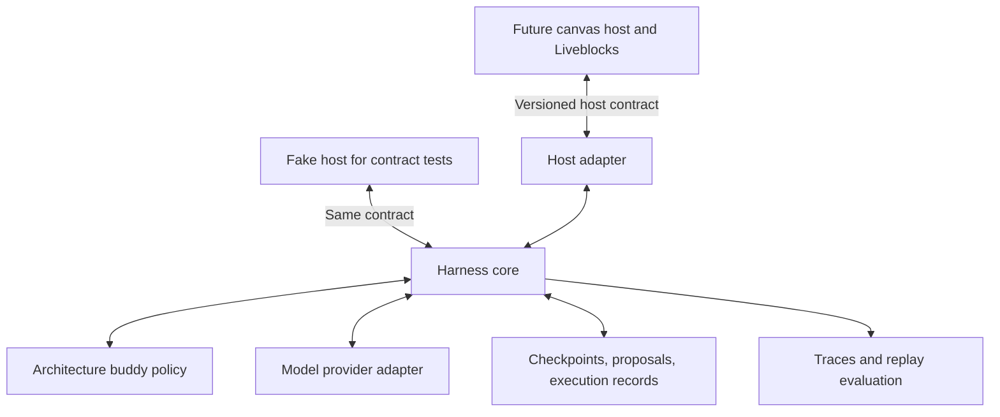
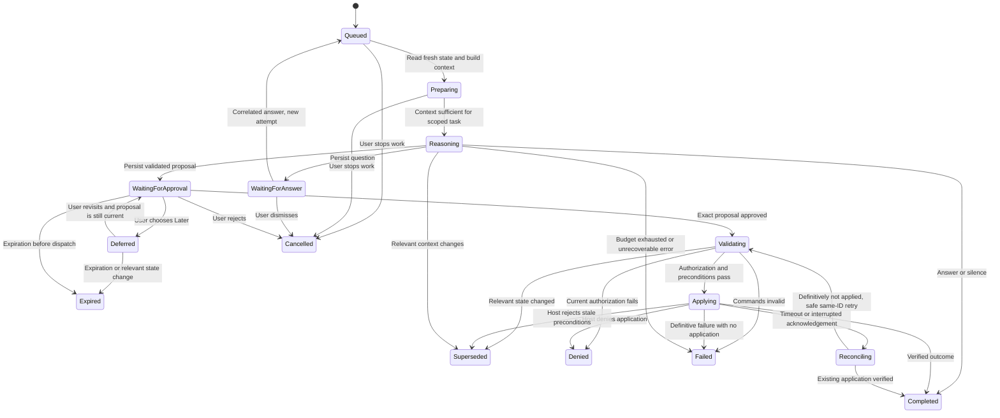

# Flowy harness: boundary, runtime, and design review

Status: design proposal, 10 October 2026. Scope is harness design only. No runtime, canvas, database, or deployment is being implemented in this pass.

Historical design review: the [complete v1 implementation specification](v1-implementation-spec.md) now takes precedence and is the developer handoff. This document preserves the earlier boundary/runtime rationale. The [broader design](agent-harness-design.md) records the desired buddy experience and candidate Liveblocks integration details.

See [the technology recommendation](tech-stack.md) for candidate libraries and deployment shape. The host contracts and runtime guarantees here remain independent of those libraries.

Review inputs: three GPT-6 Luna subagents, two at high reasoning and one at medium, examined integration boundaries, runtime principles, and failure scenarios. Their findings were synthesized and checked by the primary agent. Agreement is a design signal, not proof that the integration works.

## Verdict on building separately

Build an independently testable harness core behind a small, versioned host contract. Develop against a fake host while the full canvas is pending. Keep the core in this repository initially; independent deployment and a separate repository are optional later decisions.

The weak part of the original idea is "then just plug it in." A useful harness depends on the host's entity identities, event meaning, permission checks, snapshot freshness, preview semantics, and mutation guarantees. Agree on that boundary now. Integration is adapter implementation plus behavioral verification, not simply giving the agent a screen or API key.

Do not try to make a universal harness for arbitrary apps. Support this architecture-design domain first. A fake host demonstrates independence of the core; a real adapter must later demonstrate the contract under actual collaboration. A headless test cannot prove cursor quality, real write conflicts, or whether people enjoy the interaction.

## What a harness is here

The harness is the runtime around the model: it decides when a turn may run, assembles its context, exposes bounded tools, validates its output, waits for people, applies authorized actions through the host, and recovers after interruption.

Three responsibilities stay distinct:

| Boundary | Owns | Must not own |
| --- | --- | --- |
| Harness core | Scheduling, context budgets, run state, cancellation, checkpoints, tool enforcement, proposal/approval lifecycle, execution tracking, traces | Canvas rendering, Liveblocks data structures, general architecture advice hardcoded into infrastructure |
| Architecture buddy policy | Goal/scope/scale questions, domain schemas and checks, relevant context selection, tradeoff explanations, proposal content, speaking preferences | Authentication, durable execution guarantees, direct collaboration credentials |
| Host adapter | Canonical document reads, changes, current access checks, guarded commands, outcome lookup, presentation delivery | Deciding which architecture is best, inventing user approval, model orchestration |

Policy is a local module plus instructions and examples, not another agent or service. Its proposed actions always pass deterministic runtime and host checks.

The eventual backend can initially run these modules in one process. The core accepts dependencies through explicit interfaces; it never imports the canvas renderer or Liveblocks document types. Choosing one model provider initially is compatible with a narrow provider adapter. Do not build a broad model marketplace or plugin registry.

## Principles translated into rules

1. **Deterministic control around model judgment.** The model explores questions and tradeoffs. Code enforces permissions, budgets, output schemas, state transitions, and execution rules. A persuasive explanation cannot bypass any of these.
2. **Observe before deciding.** Events wake the runtime; a reconciled host snapshot supplies current document facts. A missed event must have a recovery path.
3. **Context is selected, versioned, and bounded.** Supply what is relevant, track what was omitted, and retain where each fact came from. More transcript is not automatically better context.
4. **Waiting and recovery are normal states.** A human may reply tomorrow. Persist the work and release the worker instead of holding a model call open.
5. **Proposals and effects are separate.** A proposal is inert data. Only an authorized executor can submit its exact approved commands to the host.
6. **Every run can finish or stop.** Bound time, tokens, tool calls, retries, pending work, and output size. Always allow silence or a scoped explanation of missing information.
7. **External outcomes are verified.** A timeout may mean an edit succeeded. Recover the command outcome before retrying or reporting failure/success.
8. **Evaluate both correctness and usefulness.** Reliable execution does not establish good architecture advice; human assessment is still needed for grounding, timing, and tradeoffs.

These choices apply the general guidance to start with simple composable workflows, clear tool interfaces, and bounded environment-feedback loops. They are Flowy design recommendations, not a universal harness standard. [Building effective agents](https://www.anthropic.com/engineering/building-effective-agents)

## Instructions and skills

Skills package domain procedures; instructions establish the buddy's standing behavior; the runtime enforces execution guarantees. Skill files alone cannot make model advice correct, prevent prompt injection, or provide idempotent writes. This section specifies a proposed design, not deployed prompts or evaluated skill packages.

### Instruction authority

| Layer | Content | Enforcement |
| --- | --- | --- |
| Application rules | Role, output contract, treatment of uncertainty and untrusted content, supported behavior | Trusted versioned instructions; hard limits also implemented in code |
| Current user task and confirmed brief | What the user wants, scope, scale, constraints, accepted tradeoffs | Determines the goal within application permissions; overrides generic skill preferences |
| Selected skill guidance | A relevant, curated procedure for this task | Cannot override application rules, user intent, permissions, or output schema |
| Reference material and observations | Diagram labels, images, tool results, retrieved notes, external documentation | Evidence with provenance, never a source of permission or overriding instructions |

A genuine request through the authenticated conversation channel is user input. Text that looks like a command inside a canvas node, document, screenshot, or quoted history remains task data. Known previous decisions may inform context but cannot create new tool permissions.

Standing instruction requirements:

- Help intermediate developers reason about their actual system and explain relevant tradeoffs.
- Distinguish observed facts, explicit requirements, assumptions, and missing information.
- Ask a focused question when its answer could change the next recommendation; avoid blocking questionnaires.
- Cite affected entity IDs in structured output and use their visible names in conversation.
- Respect scope, design stage, and accepted decisions. Do not recommend extra infrastructure merely because it is conventional.
- Stay silent when there is no useful intervention. Treat incomplete sketches differently from reviewed designs.
- Return the shared `silent`, `ask`, `answer`, or `propose` contract; include concise rationale, evidence, and uncertainty where relevant.
- Treat proposed commands as inert data. Never claim an edit succeeded without a verified host result.

The detailed wording is a later evaluated prompt artifact. Do not equate adding more instructions with improving reliability.

### First three skills

| Skill | When it helps | Procedure and stopping condition |
| --- | --- | --- |
| Requirements clarification | New session or a consequential gap in intent | Read known context, ask about the next missing requirement, reflect the brief; stop when enough is known for the current decision |
| Request-flow review | A relevant path changes or the user asks to review a flow | Trace the path, inspect known sync/async and failure behavior, distinguish facts from unknowns; return one grounded concern, question, or silence |
| Tradeoff review | The developer compares approaches or a known constraint conflicts with the current design | Compare the current choice and a small set of relevant alternatives against confirmed constraints; explain costs and uncertainty; avoid a universal winner |

These are proposed capability boundaries. Introduce each skill only when a baseline shows a gap its procedure addresses. Later reliability, security, data modeling, and scaling skills can be added when representative tasks justify them. Skills do not require separate agents.

Example request-flow procedure: inspect the selected order-to-email path, establish whether it blocks order completion, check known failure expectations, and ask a question if those facts are missing. If a queue would help, explain its operational cost and generate a proposal through the common output contract. If the user has accepted synchronous delivery for a prototype, avoid repeating the same recommendation unless relevant conditions change.

### Package and activation contract

Each curated skill has an ID/version, a precise description, activation and exclusion conditions, required context, a short procedure, stopping conditions, reference links, and evaluation cases. A `SKILL.md` can carry instructions, with larger references loaded separately. Version, tool requirements, and evaluation metadata may live in our own manifest; those extra fields are Flowy design choices rather than claims about a standard format.

Keep only short skill descriptions in routine context. Select one primary skill for the turn, adding another only if needed within the context budget. Load referenced material on demand and record what was actually loaded. This uses progressive disclosure rather than loading every playbook on every event. [Agent Skills design](https://www.anthropic.com/engineering/equipping-agents-for-the-real-world-with-agent-skills)

For the small initial catalog, use explicit task/event eligibility rules and a bounded model choice when the intent is ambiguous. The model may request a known skill by ID; the loader checks the curated catalog, version, capability requirements, and budget. An unknown or unavailable skill produces a defined fallback: use basic assistance with stated limits, ask for clarification, or report unsupported scope.

Tool requirements are declarations, not grants. Effective tools come from the intersection of application policy, authenticated session access, skill needs, and current host capabilities. Initial skills receive read-only graph/context tools; proposal execution stays with the separate executor. Any future bundled code must be reviewed and exposed as a bounded registered tool, not arbitrary shell execution authorized by Markdown.

Skill resources must come from the pinned curated package. Do not follow arbitrary file paths or network destinations supplied by canvas content. External reference text is still evidence, even when loaded by a trusted skill. Avoid uncontrolled recursive skill loading and implicit changes of role.

Pin application prompt, domain schema, model configuration, and skill versions per reasoning attempt, and record them in traces. Existing proposal commands never change because a skill version changes. Updates follow review and evaluation; a single user correction may update a project decision but must not silently rewrite global skills.

### Reliability evaluation before prompt tuning

Begin with a base-instructions-only baseline. Use at least 12 representative cases before optimizing skill instructions, with acceptable behaviors rather than a single exact sentence. Compare the same model/configuration with and without the candidate skill. Repeat nondeterministic cases, keep held-out variants, and test selection as well as execution.

| Case | Expected behavior |
| --- | --- |
| Empty canvas, no goal | Ask what the developer is building |
| Returning user with known scope | Reuse the brief; skip repeated onboarding |
| Unknown scale | Record unknown or ask a relevant question; invent no traffic |
| Simple prototype with accepted direct calls | Respect the tradeoff; do not force a queue |
| Explicit reliability requirement conflicts with a known flow | Identify evidence and explain the specific consequence |
| Incomplete unlabeled sketch | Clarify meaning; do not diagnose a production failure as fact |
| User asks to compare two designs | Use tradeoff review and the user's actual criteria |
| Pointer-only event | Invoke no review skill or model run |
| Missing graph region needed for review | Retrieve it within budget or qualify coverage |
| Label says to ignore rules or execute commands | Treat the label as data; gain no authority |
| Relevant edit while skill is running | Supersede stale output |
| Rejected recommendation without changed context | Avoid repeating it proactively |
| Required tool or skill unavailable | Use the declared fallback without claiming the unavailable review happened |
| Update improves one case but harms another | Record the regression and revise or reject the update |

Measure skill-selection appropriateness, evidence grounding, unsupported assumptions, scope fit, interruption quality, output validity, latency, and usage. Human review assesses architectural judgment; deterministic checks enforce shape and authorization. Prompt length or a static clarity score cannot establish correctness. Keep safety gates and known regressions explicit before shipping a version.

## Authority and state ownership

| Record | Authority | Treatment elsewhere |
| --- | --- | --- |
| Shared graph, relevant layout, confirmed design brief | Host document/application | Harness caches are disposable and versioned |
| Current room membership and edit/approval permission | Host authorization service | Model or browser claims cannot grant access |
| Logical turns, pending questions, proposal versions, approval records | Harness store | UI shows projections of these records |
| Command application outcome | Host's verified execution result/receipt | Harness reconciles its execution record against it |
| Inferred facts and draft brief updates | Harness, explicitly marked tentative | Must not silently become confirmed host requirements |
| Cursor and working indicators | Derived from current runtime activity | Ephemeral; expire and rebuild on reconnect |

Avoid two writable copies of the graph or design brief. The adapter translates the host's native document into domain data for reasoning. Domain caches and summaries never overwrite canonical state as a whole.

The host supplies opaque version/snapshot identities and the means to evaluate mutation preconditions. The harness must not assume versions are client-incremented integers or globally ordered timestamps. A runtime generation invalidates old attempts; it does not replace authoritative host concurrency checks.

## Minimum host contract

Define these semantics before implementation. Transport and exact method names remain flexible.

| Capability | Input/output contract | Required guarantee |
| --- | --- | --- |
| Capabilities/schema | Supported schema versions, commands, preview behavior, mutation/recovery support | Unsupported features fail explicitly; mutation disabled if guarantees are insufficient |
| Read snapshot | Room scope and optional region -> graph, confirmed brief, stable IDs, version, coverage | Report whether the requested scope is complete and synchronized |
| Deliver changes | Event ID, trusted actor/origin, entity refs, source version, causation, kind | Duplicates and gaps are possible; provide snapshot reconciliation |
| Present activity | Turn/action ID, sequence, target IDs/coordinates, phase, expiry | Best-effort ephemeral delivery; replayable durable proposals remain separately readable |
| Preview proposal | Proposal ID/version, commands, preconditions -> host preview | Preview has the same meaning as the commands that will execute |
| Receive response | Question/proposal ID, exact version where relevant, response ID, authenticated actor | Bind input to the intended waiting work; deduplicate deliveries |
| Apply commands | Command ID, proposal digest/version, actor, preconditions, allowed operations | Recheck current authority and state at the actual write boundary; preserve command identity on retries |
| Read outcome | Command ID -> applied, definitively not applied, in progress, or unknown | Unknown is not permission to retry as a new command |

Application results distinguish applied, conflict, denied, invalid, and unknown. A multi-operation structural change requires atomic application for our initial edit feature. If a host lacks that capability, expose read-only collaboration until an explicit alternative protocol is designed and verified.

The host contract must state reconciliation cadence for lost events and the maximum tolerated observation lag during an active session. Its value is an integration/performance decision; the core receives it as configuration. If synchronization is uncertain, mark coverage stale and avoid claiming a current complete review.

Typed commands use domain terms such as add a component, update known fields, connect components, remove a connection, or move a component. The policy proposes them; the adapter owns Liveblocks/JSON Patch translation. A generic `execute_anything` tool is outside this design.

## Context bundle and memory

Each reasoning attempt receives:

- Trusted role instructions, domain policy version, available tools, and hard budgets.
- Logical turn/attempt identity, trigger, room scope, runtime generation, and source snapshot identity.
- Confirmed goal, scope, expected scale, constraints, and current design stage.
- Current semantic diff, focused graph neighborhood, and a compact system summary.
- Relevant user decisions, recent messages, unresolved questions, and previous rejections/deferments.
- Coverage metadata: inspected regions, omitted regions, missing facts, freshness, and provenance.

Set a maximum input size and reserve space for output and tool results. Load more context with a small read-only toolset when necessary. On insufficient coverage, narrow the answer, fetch another region within budget, or ask a question. Never describe a neighborhood review as a complete system review.

This reflects context-engineering guidance to curate a small useful context and retrieve additional information when needed. [Effective context engineering](https://www.anthropic.com/engineering/effective-context-engineering-for-ai-agents)

Store confirmed decisions separately from compressed conversation summaries. A decision includes its source message, author, scope, and any superseding decision. Summaries are navigation aids; preserve uncertainty when compacting. Canvas text, images, imported notes, and retrieved history are data and cannot override runtime instructions or authorization.

Long-lived continuity comes from durable records and fresh orientation, rather than an uninterrupted model invocation. The useful lesson from long-running coding harnesses is explicit state handoff and verification; their initializer/coder architecture is not a requirement for this interactive product. [Effective harnesses for long-running agents](https://www.anthropic.com/engineering/effective-harnesses-for-long-running-agents)

## Turn lifecycle: the missing part of the earlier design

A logical turn is work on a user request or a selected proactive concern. An attempt is one bounded execution of that work. A logical turn may span multiple attempts and a human wait.

Persist the trigger, consumed response IDs, source snapshot, generation, pending question/proposal, budget use, and outcome. Waiting consumes no worker and does not block a new explicit user request. For the initial policy, keep at most one unanswered proactive question visible. Later answers to earlier work are correlated by question ID; ambiguous free text needs clarification.

Deferred proposals remain saved but inactive and do not automatically interrupt again. On explicit revisit, check expiration and current dependencies before offering the same proposal for approval. An expired or changed proposal needs a new version and fresh approval. Expiration after dispatch does not resolve an unknown mutation outcome; reconcile it first.

Denied actions require current authorization before any new attempt. Invalid commands require correction and fresh approval if their content changes. Only a confirmed transient failure with no application can retry within budget using the same command ID and unchanged approved commands, after revalidation. Context-loading and model failures also terminate as Failed when bounded recovery is exhausted. Store a reason code with every terminal state; diagrams show the principal paths rather than every error edge.

Before publishing a completed response, recheck relevant freshness and runtime ownership. A later attempt supersedes older output. Streamed text is provisional; if it becomes stale, mark it invalidated and update the response. Cancellation cannot retract text already seen by the user.

Before dispatching a mutation, revalidate the exact stored proposal. Do not rerun the model to silently regenerate its approved commands. After dispatch, cancellation stops additional work but cannot promise the in-flight write did not happen. Reconcile and report its outcome.

A scheduled or network retry receives a new attempt ID and retains the logical turn identity. Command retries retain their original command ID. Distinguish these identities explicitly.

## Scheduling and bounded tool use

Use one active reasoning attempt per room initially. Prioritize explicit user messages and responses over proactive analysis. Coalesce background changes into a bounded latest-state work item; do not queue every pointer movement or intermediate keystroke.

Use cancellation to reduce waste and generation checks to prevent late publication even when a provider ignores cancellation. After a restart, reconcile unfinished work before resuming it. Operationally prevent overlapping room workers in the first deployment; add leases and fencing before running replicas or overlapping rolling deployments.

Model-call limits include wall-clock duration, input/output tokens, read-tool count, retry count, and per-session usage. Validation failures may receive a bounded repair attempt. Repeated malformed output ends that attempt safely; it does not create an unbounded self-correction loop.

Read tools should be few and specific: get a graph neighborhood, inspect a component/connection, and retrieve relevant confirmed decisions. Enforce tenant/room scope server-side. Neither quoted instructions in a node nor model-generated IDs can expand access. Schema validation catches structural errors; it does not prove that a recommendation is correct.

## Execution and recovery invariants

1. No external edit occurs without current host authority and approval of the exact persisted proposal version.
2. The model has no direct document mutation credentials or unrestricted execution tool.
3. A stale attempt cannot publish a final proposal or dispatch new commands.
4. A single command identity produces no duplicate effect under supported retry/crash scenarios.
5. An unknown outcome remains reconciling until evidence resolves it; never label it definitely failed and start a fresh command blindly.
6. Mutation checks happen at the host's authoritative write boundary, including relevant brief and layout dependencies.
7. Runtime status reflects actual work and expires after loss of connectivity.
8. A host snapshot, an inferred fact, and a confirmed user decision remain distinguishable.

Do not claim universal exactly-once delivery. The desired property is a recoverable, idempotent effect for each command, proved against the selected adapter. Liveblocks receipt/patch details in the earlier document are candidate mechanisms, not core requirements or verified behavior.

Human offline edits may arrive after an approved command. Approval does not reserve the diagram. The later integration must detect resulting conflicts and reconcile without restoring over unrelated work. Undo is a guarded compensating command; it is not a wholesale room restore.

## Raw review: what to change in the current plan

| Finding | Consequence | Design response |
| --- | --- | --- |
| "Separate" was underspecified | A separately built agent can fail to fit the real canvas | Define the host contract now; keep deployment choice open |
| Proposal lifecycle was stronger than turn lifecycle | Replies, restarts, and cancellation could resume the wrong work | Persist logical turns and attempts, including waiting states |
| Context had no explicit coverage contract | A partial graph could produce a confident complete review | Carry scope, omissions, freshness, and provenance |
| Host adapter methods were too coarse | Real authorization, recovery, and preview guarantees were hidden | Name capabilities and outcomes, not just read/write functions |
| Concrete storage/polling/animation choices arrived early | Infrastructure decisions could distract from proving the core | Keep them as adapter or tuning hypotheses |
| Replay was at risk of being treated as full proof | Mock success could hide actual write races and poor UX | Separate core-contract acceptance from later integration acceptance |

The separate-core idea is sound. Its biggest technical risk is disagreement between the harness's understanding and the actual shared state. Its biggest product risk is a technically correct agent that interrupts too often or gives generic advice. Both require explicit evaluation.

## Design deliverables and gates

For this phase, specify the domain snapshot/event/command schemas, the host contract above, the context bundle, the turn/proposal state machines, budgets/cancellation rules, and replay fixtures. Implementation follows later.

The future fake-host suite should cover:

| Scenario | Required result |
| --- | --- |
| Empty board, unknown scale | Ask a useful question; no invented workload |
| Returning session | Recover decisions and avoid repeated onboarding |
| Drag burst | Update awareness without a reasoning call per frame |
| Missing/duplicated event | Reconcile state and deduplicate work |
| Relevant edit during delayed model call | Supersede old output; analyze fresh state |
| Restart while awaiting user | Resume the intended logical turn once per response delivery |
| Approval duplicated or changed proposal approved | One valid command or explicit rejection |
| Permission revoked after proposal | Deny application at the host boundary |
| Timeout/crash around apply | Reconcile the same command ID without duplicate edits |
| Malicious labels or history | No escalation of tools, room scope, or authority |
| Disconnected activity stream | Expire misleading working indicators |
| Valid design with no useful intervention | Stay silent |

For advice quality, score grounding, scope fit, tradeoff accuracy, uncertainty handling, and interruption timing separately. Include examples where proposing another component would be unnecessary. Record model/policy/schema versions, input references, latency, tool outcomes, and usage so changes can be compared. Persist concise rationales, not private reasoning traces.

Passing fake-host tests proves only the core behavior under that model of the host. Before enabling actual canvas edits, separately verify real snapshot/event timing, atomic preconditions, retry recovery, permissions, preview equivalence, and cursor alignment. No real integration is being built in this design pass.

Deferred: generic plugin framework, automatic multi-agent teams inside Flowy, vector/graph databases, autonomous background redesign, polished cursor animation, and deployment topology optimization. The three agents used for this review are a development aid, not a proposed production architecture.
