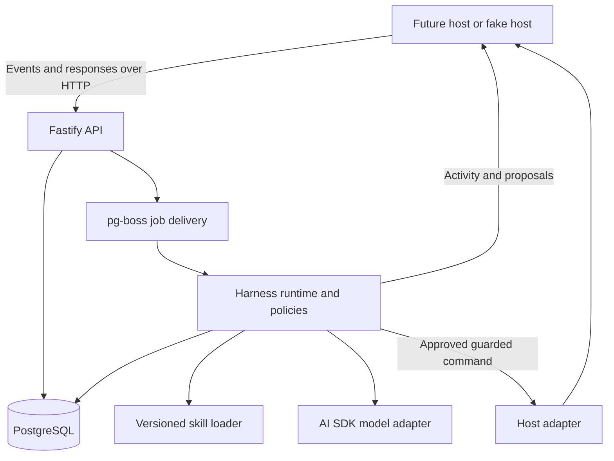

# Flowy harness: recommended starting stack

Status: earlier stack discussion, 10 October 2026. No packages have been installed. The [complete v1 implementation specification](v1-implementation-spec.md) now sets the implementation defaults and takes precedence; this document preserves the technology rationale and alternatives.

## Recommendation

Use TypeScript on Node.js, Fastify for the service API, AI SDK Core for model calls, Zod for domain contracts, PostgreSQL for durable state, Drizzle for database access, and pg-boss for background jobs. Store skills and instructions in Git. Use Vitest and recorded sessions to evaluate behavior. Integrate Liveblocks behind the host adapter when the canvas is ready.

Start with one service process running API and worker modules, one PostgreSQL database, and one model provider. The harness core remains a local package independent of the UI. This is enough of an independent boundary for later integration without creating several services first.

## Technology map

| Responsibility | Proposed technology | Use in Flowy |
| --- | --- | --- |
| Language/runtime | TypeScript strict mode, Node.js 24 LTS | Shared domain types and an event-driven backend |
| Repository/package management | pnpm workspaces | Harness, domain schemas, adapters, and evaluations in this repository |
| HTTP API | Fastify | Authenticated events, user responses, proposals, health checks |
| Model integration | AI SDK Core and one provider package | Text generation, streamed output, tool calls, structured decisions |
| Domain validation | Zod | Snapshots, events, context bundles, model output, skills, commands |
| Agent orchestration | Small application-owned TypeScript state machine | Turn lifecycle, freshness, speaking policy, approval gates |
| Durable records | PostgreSQL | Turns, questions, decisions, proposals, approvals, executions, traces |
| Database access/migrations | Drizzle ORM, Drizzle Kit, PostgreSQL driver | Typed queries and reviewed schema migrations |
| Background delivery | pg-boss | Durable work dispatch and bounded retries using the same PostgreSQL installation |
| Client transport | HTTP ingress; SSE for provisional output/activity | Connect the host to the harness without making the core transport-specific |
| Skills/instructions | Versioned Markdown and JSON manifests in Git | Curated procedures, references, versions, and evaluation cases |
| Logging | Pino through Fastify, correlated run records | Trace a room/turn/attempt/command and explain failures |
| Tests/evaluations | Vitest, fake host/model, JSON/JSONL replay fixtures | Verify runtime behavior and compare advice quality |
| Local environment | Node.js and pnpm locally; PostgreSQL accessed through a configured connection string | Develop and test the API, storage, and worker without Docker |
| Later packaging | Docker deferred until the deployment phase | Decide packaging when hosting requirements are known |
| Later collaboration integration | Liveblocks Node adapter plus the chosen canvas document API | Shared graph reads, agent presence, guarded edits |

Node 24 is listed as LTS in the checked release table; pg-boss currently requires Node 22.12+ and PostgreSQL 13+. Pin compatible package/database patch versions when implementation starts and verify them together; the minimum supported database version is not a recommendation to deploy an old database. [Node releases](https://nodejs.org/en/about/previous-releases), [pg-boss requirements](https://github.com/timgit/pg-boss#requirements)

pnpm supports multiple local packages in one workspace. Start with workspace scripts; a separate build orchestrator is unnecessary for this initial package count. [pnpm workspaces](https://pnpm.io/workspaces)

## What libraries cover, and what we must write

Fastify provides the request boundary and schema-validation hooks. Zod defines the domain structures and validates model/tool data. Fastify does not automatically interpret arbitrary Zod objects as route schemas: use a reviewed validation integration or derive compatible JSON Schemas from representable Zod contracts, with boundary tests. Check richer refinements in application validation. [Fastify validation](https://fastify.dev/docs/latest/Reference/Validation-and-Serialization/), [Zod](https://zod.dev/)

AI SDK Core provides generation, streaming, tools, and structured output. Keep it behind our model adapter. The selected provider/model must actually support the features used; provider behavior is part of the integration tests. Schema-shaped output still needs domain checks and does not prove sound architecture advice. The SDK is not our persisted turn/approval lifecycle. [AI SDK Core](https://ai-sdk.dev/docs/ai-sdk-core/overview)

We write the room scheduler, bounded context builder, skill selection policy, instruction composition, turn transitions, proposal validation, and executor. We do not implement an LLM provider protocol or general durable workflow framework.

Drizzle provides TypeScript database schemas and SQL-style access. Keep transactions, uniqueness constraints, approval versions, and command identities explicit. JSONB can store bounded variable-shaped context/command payloads; use relational columns for IDs, status, ownership, and critical constraints. The graph remains owned by the future host, not copied into a second editable source of truth. [Drizzle](https://orm.drizzle.team/docs/overview), [PostgreSQL JSON types](https://www.postgresql.org/docs/current/datatype-json.html)

pg-boss handles durable jobs and retry/backoff support on PostgreSQL. It reduces the need for a separate queue server. Our runtime still decides which work should run and protects the host against duplicate effects. Job completion is not proof that a remote canvas edit completed exactly once. [pg-boss](https://github.com/timgit/pg-boss)

## Execution shape

API and job workers are initially modules within the same service. Persist important input and its work dispatch consistently, using an appropriate transaction or recoverable outbox pattern. Coalesce bursts into latest-state room work. A duplicate job must not create a duplicate proposal or command.

When a turn waits for a human, save it and finish the job. A correlated answer or approval creates new bounded work. Do not hold a queue worker, network request, or model invocation open for a human wait.

Start with one operational owner per room. Queue worker concurrency alone does not establish room ownership. Add explicit persisted ownership/fencing before replicas or overlapping deploys, as required by the harness specification.

SSE can carry provisional text and status; persisted proposals/turns are recovered through reads after disconnects. Later, map relevant activity into Liveblocks Presence/Feeds as the host presentation contract requires. Actual cursor animation is rendered by the host from targets and coordinates. Avoid two competing sources of truth for proposal status or document edits.

## Custom runtime versus an agent framework

| Choice | Fit | Tradeoff |
| --- | --- | --- |
| Small TypeScript lifecycle + AI SDK Core + PostgreSQL jobs | Recommended for the initial bounded question/proposal/approval flow | We must test state transitions and recovery ourselves |
| LangGraph JS with persistent checkpoints | Worth reconsidering if workflows acquire many resumable model/tool steps | Adds framework state and replay semantics; application authorization and safe host edits are still our responsibility |
| General autonomous coding agent | Poor starting fit for the current canvas domain | Broad tools and filesystem-oriented behavior do not supply our shared-canvas contracts |

LangGraph supports persisted thread checkpoints and human interrupts. Resumed nodes can rerun prior code, so side effects must be designed for replay. Do not combine LangGraph and a second custom checkpoint engine without a clear state owner. If it becomes the better fit, adopt it behind the reasoning workflow boundary with explicit migration work. [LangGraph persistence](https://docs.langchain.com/oss/javascript/langgraph/persistence), [interrupt behavior](https://docs.langchain.com/oss/javascript/langgraph/interrupts)

The choice is about our current control flow and maintenance cost, not whether one framework is universally better. Test the basic persisted-turn spike before committing to broader runtime code.

## Model selection, skills, and tools

Choose one primary production model after running the representative cases in the harness specification. Requirements are grounded advice, reliable structured decisions/tool arguments, acceptable interactive latency/cost, and image support if visual context is included. The GPT-6 Luna subagents used in our design discussion do not determine the product model.

Use the appropriate AI SDK provider adapter. Production provider/account, exact model, budgets, and retention terms remain open. A second cheaper model or automatic model router should be introduced only after measurement supports it. Record usage per attempt and enforce room/session budgets.

Skills are Markdown procedures with schema-validated JSON metadata and pinned versions. Their content lives in this repository rather than a database service. Tools are registered, room-scoped TypeScript functions exposed through the model adapter. The executor is the only path to mutations. An MCP integration may become useful for external tools later; it is unnecessary for local typed functions.

## Logs and evaluations

Enable Fastify's Pino logger and correlate requests with room, logical turn, attempt, proposal, and command IDs. Record source versions, selected skills, latency, model usage, tool outcomes, and state transitions. Redact credentials and avoid uncontrolled storage of user content. A hosted tracing tool can be added when inspecting traces becomes a bottleneck. [Fastify logging](https://fastify.dev/docs/latest/Reference/Logging/)

Use Vitest for meaningful runtime and contract tests. The fake host/model control event ordering, delayed outputs, approval races, and ambiguous command outcomes. Store recorded evaluation cases in Git and write run results separately. Human review scores tradeoffs, grounding, and interruption timing; valid JSON alone cannot establish quality. [Vitest](https://vitest.dev/guide/)

## Development, hosting, and later product pieces

Run the harness locally in Node watch mode with pnpm scripts. Connect to a locally installed PostgreSQL instance or an existing development database through a configured connection string. Docker and containerization are deferred at the user's request; they are not requirements for the initial build.

Choose deployment packaging later. The deployed harness needs a supported path for persistent background work; a request-only deployment needs a separately supported worker path. Waiting work must already be durable.

Cloud provider and paid plan remain open until deployment requirements and budget are known. Start CI with type checks, meaningful runtime tests, migrations against disposable PostgreSQL, and fake-host contract tests. Run model evaluations deliberately rather than charging live-model calls on every trivial edit.

The future canvas application supplies authenticated identity. Keep a verification/access-check port in the harness; select the concrete token/session integration with the host. Recheck current host permissions for edits instead of trusting an old token's claims as permanent permission. Test identities belong only to the fake-host environment.

React is a plausible later UI choice. The actual canvas renderer remains open because Excalidraw is the desired experience reference and we have not selected its document representation. Liveblocks is the confirmed collaboration direction. These UI decisions must fit the host contract, but are not part of harness implementation now.

Initial infrastructure is one backend service, one PostgreSQL installation, and a model API account. No separate Redis, vector database, graph database, Kubernetes cluster, or multi-agent runtime is justified by the current requirements. Model call frequency and context size are cost variables to measure; there is no priced or benchmarked operating estimate yet.

## Open decisions before implementation

Agree on TypeScript as the working language and the custom-lifecycle starting approach. Select the primary model/provider through evaluation, and pin compatible package versions in a lockfile. Confirm the native canvas/document representation before building the real host adapter. Choose cloud hosting and the authentication integration when the host and deployment scope are defined.
